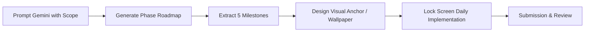

# 🗺️ Gemini Project Roadmap

## 1. Project Overview & Vision
- **Project Name:** Embarko - Final Boarding
- **Author:** [Your Name / Team Name]
- **Target Goal:** [Define your primary goal, e.g., Full-Stack AI Application Development, Cloud Engineering Mastery, etc.]
- **AI Planning Partner:** Google Gemini

---

## 2. Strategic Objectives
1. **Foundation & Alignment:** Establish core competencies and technical prerequisites guided by Gemini.
2. **Iterative Prototyping:** Break down architectural design into measurable development sprints.
3. **Daily Visual Commitment:** Translate long-term goals into visual anchors (lock screen wallpaper) to reinforce daily progress.
4. **Validation & Proof of Work:** Continuously document Gemini prompt workflows, implementation iterations, and evidence.
5. **Final Delivery & Showcase:** Assemble polished documentation, design assets, and submission artifacts.

---

## 3. Gemini Collaboration Workflow

### Key Gemini Prompt Prompts Used:
- **Roadmap Synthesis:** `"Act as a principal mentor. Break down my journey toward [Goal] into actionable phases, identifying potential roadblocks and high-leverage learning milestones."`
- **Milestone Decomposition:** `"Extract 5 distinct, measurable, chronological milestones with explicit completion criteria and deliverables."`
- **Visual Design Ideation:** `"Brainstorm minimalist, modern visual motifs, color palettes, and typography for a smartphone wallpaper that daily reminds me of my 5 milestones."`

---

## 4. Phase Breakdown & Timeline

| Phase | Focus Area | Target Timeline | Key Gemini Deliverable |
| :--- | :--- | :--- | :--- |
| **Phase 1** | Discovery & Scope Definition | Week 1 | Clarified goals & prerequisite stack |
| **Phase 2** | Architecture & Milestone Mapping | Week 2 | `Five-Milestones.md` specification |
| **Phase 3** | Visual Identity & Wallpaper Design | Week 3 | Visual concepts for `Final-Wallpaper.png` |
| **Phase 4** | Execution & Proof Collection | Week 4 | Screenshots & prompt transcripts |
| **Phase 5** | Packaging & Submission | Week 5 | `Project-Description.md` & `Cover.png` |

---

## 5. Risk Assessment & Mitigation Strategies
- **Scope Creep:** Constrain scope strictly to the 5 designated milestones.
- **Inconsistency / Drop-off:** Reinforce daily habit through the custom lock screen wallpaper visual reminder.
- **Verification Gaps:** Maintain live logs and prompt transcripts in `03-Proof/Gemini-Planning-Evidence/`.

