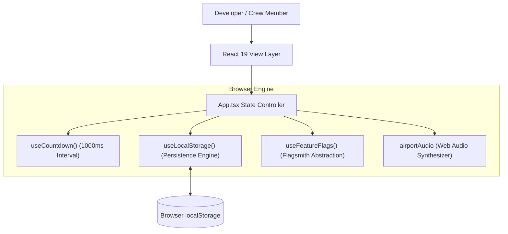

# 🛫 FINAL BOARDING
### *Every Deadline Is a Departure Time.*

[](https://react.dev/)
[](https://www.typescriptlang.org/)
[](https://vite.dev/)
[](https://tailwindcss.com/)
[](LICENSE)

An airport-terminal-inspired project execution and deadline-management system. FINAL BOARDING reframes project milestones into scheduled flight departures, transforming passive deadline anxiety into a structured, sensory control-tower workflow.

---

## 📑 Table of Contents

- [Live Demo & Previews](#-live-demo--previews)
- [The Problem](#-the-problem)
- [The Solution](#-the-solution)
- [Key Features](#-key-features)
- [Design Philosophy](#-design-philosophy)
- [Technology Stack](#-technology-stack)
- [System Architecture](#-system-architecture)
- [Repository Structure](#-repository-structure)
- [Installation & Quickstart](#-installation--quickstart)
- [Deployment (Vercel)](#-deployment-vercel)
- [Data Persistence](#-data-persistence)
- [Feature Flags & Flagsmith Prep](#-feature-flags--flagsmith-prep)
- [Known Limitations](#-known-limitations)
- [Future Roadmap](#-future-roadmap)
- [Contributing](#-contributing)
- [Documentation Index](#-documentation-index)
- [License & Authors](#-license--authors)

---

## 🌐 Live Demo & Previews

- **Live Production URL:** *[Deployment Link Pending — Host via Vercel or Netlify]*
- **Local Development URL:** `http://localhost:5173/`

### Interface Preview Placeholders
```
+-----------------------------------------------------------------------------------+
|  [●] FLIGHT CONTROL LIVE | EVENT: FLAGSMITH HACKATHON | UTC: 16 NOV 2026 21:40    |
+-----------------------------------------------------------------------------------+
|  🛫 FINAL BOARDING [FL-2026]                     [AUDIO ON]  [RESET]  [CONFIG]    |
+-----------------------------------------------------------------------------------+
|  [CONTROL TOWER]   [FLIGHT BOARD]   [DAILY MISSIONS (3)]   [RECOVERY RADAR]       |
+-----------------------------------------------------------------------------------+
|  NOW BOARDING | FINAL DEPARTURE COUNTDOWN                                         |
|  [ 13 DAYS ]      [ 02 HOURS ]      [ 18 MINUTES ]      [ 44 SECONDS ]            |
|                                                                                   |
|  FLIGHT PROGRESS: 20%  |  GATE CLEARANCE: 1/5  |  CREW MISSIONS: 40%             |
+-----------------------------------------------------------------------------------+
```

---

## 🛑 The Problem

Conventional project trackers treat deadlines as passive dates on a calendar. This induces two major failure modes:
1. **The Silent Delay:** Slipped intermediate milestones sit quietly in a backlog. Teams assume they will "make up time later," compounding friction until final delivery is compromised.
2. **Abstract Urgency:** Static dates fail to convey the finite passage of time, leading to Parkinson's Law where non-essential scope consumes available runway.

---

## ✈️ The Solution

FINAL BOARDING borrows the strict, disciplined operational model of commercial aviation:
- **Every deadline is a departure time:** When wheels are up, the gate is sealed.
- **Milestones are flight gates:** Projects follow 5 chronological gates (`FL-01` to `FL-05`) from Flight Plan to Final Runway.
- **Delays trigger the Rebooking Desk:** Slipped deadlines cannot be ignored; they are quarantined in the **Recovery Radar** until an engineer explicitly rebooks a revised departure date with a mitigation rationale.
- **Sensory feedback:** Synthesized airport chimes (ding-dong), mechanical split-flap sounds, and celebratory confetti reinforce momentum.

---

## ✨ Key Features

- **Control Tower Dashboard:** Real-time ticking split-flap countdown (days, hours, minutes, seconds), project telemetry metrics, next departure spotlight card, and full gate departure schedule.
- **Flight Board (Milestones):** Visual runway timeline connecting all 5 milestones. Supports full lifecycle states: `ON TIME`, `IN PROGRESS`, `DELAYED`, `DONE`, and `REBOOKED`.
- **Crew Missions (Daily Tasks):** Tactical task manager categorized by flight stage (`PRE-FLIGHT`, `AVIONICS`, `PAYLOAD`, `QUALITY`, `FINAL RUNWAY`) with priority flags and daily completion rate gauges.
- **Recovery Radar:** Automatic scanner isolating overdue gates and delayed directives, spotlighting an **Immediate Unblocking Directive** to regain runway momentum.
- **Avionics Config Console:** In-app customization of project title, tagline, hackathon event name, and departure deadline. Includes a confirmed factory-reset modal.
- **Zero-Asset Web Audio Synthesizer:** Embedded Web Audio API oscillator synthesis generating authentic airport two-tone announcement chimes, mechanical flap clicks, and celebratory harmonic tones without downloading MP3s.
- **Client Feature Flag Architecture:** Prepared abstraction layer ready for drop-in Flagsmith remote experimentation.

---

## 🎨 Design Philosophy

Built on an airport control terminal glassmorphism aesthetic:
- **Midnight Black (`#0B0C0E`):** Deep runway night sky background.
- **Airport Amber (`#FFB000`):** High-visibility terminal signage and active gate accent.
- **Warm Cream (`#EDE8DC`):** High-contrast text readability without eye fatigue.
- **Muted Slate (`#8E929B`):** Secondary flight telemetry indicators.
- **Frosted Glass Cards:** Semi-translucent panels (`backdrop-blur-xl`, `border-white/[0.08]`, `bg-[#121418]/70`).

---

## 🛠️ Technology Stack

- **Runtime & UI:** React 19, TypeScript 5.7, Vite 6
- **Styling:** Tailwind CSS v4 (`@tailwindcss/vite`), custom `@theme` tokens
- **Icons:** Lucide React (`^1.16.0`)
- **Effects:** Canvas Confetti (`^1.9.4`)
- **Audio:** Native Browser Web Audio API (`AudioContext`, Oscillator nodes)
- **Persistence:** Browser `localStorage` with safe JSON parsing guards

---

## 🏗️ System Architecture



For comprehensive details, see the [System Architecture Document](docs/SYSTEM_ARCHITECTURE.md).

---

## 📁 Repository Structure

```
FINAL-BOARDING/
├── .github/
│   ├── ISSUE_TEMPLATE/
│   │   ├── bug_report.md
│   │   └── feature_request.md
│   └── PULL_REQUEST_TEMPLATE.md
├── docs/
│   ├── PROJECT_OVERVIEW.md
│   ├── PRODUCT_REQUIREMENTS_DOCUMENT.md
│   ├── PROBLEM_STATEMENT.md
│   ├── SOLUTION_OVERVIEW.md
│   ├── FEATURES.md
│   ├── SYSTEM_ARCHITECTURE.md
│   ├── TECH_STACK.md
│   ├── DATA_MODEL.md
│   ├── USER_GUIDE.md
│   ├── INSTALLATION_AND_SETUP.md
│   ├── DEVELOPMENT_GUIDE.md
│   ├── DEPLOYMENT_GUIDE.md
│   ├── FEATURE_FLAGS.md
│   ├── SECURITY_AND_PRIVACY.md
│   ├── TESTING_STRATEGY.md
│   ├── KNOWN_LIMITATIONS.md
│   ├── ROADMAP.md
│   └── FAQ.md
├── src/
│   ├── components/
│   │   ├── dashboard/
│   │   ├── layout/
│   │   ├── milestones/
│   │   ├── missions/
│   │   ├── recovery/
│   │   ├── settings/
│   │   └── ui/
│   ├── data/
│   │   └── initialData.ts
│   ├── hooks/
│   ├── pages/
│   ├── types/
│   ├── utils/
│   ├── App.tsx
│   ├── main.tsx
│   └── index.css
├── index.html
├── package.json
├── tsconfig.json
├── vite.config.ts
├── LICENSE
├── CONTRIBUTING.md
├── CODE_OF_CONDUCT.md
├── SECURITY.md
└── CHANGELOG.md
```

---

## 🚀 Installation & Quickstart

```bash
# 1. Clone repository
git clone https://github.com/aastha-yadav2/Final-Boarding.git
cd Final-Boarding

# 2. Install dependencies
npm install

# 3. Start local development server
npm run dev

# 4. Build for production (TypeScript check + Vite bundle)
npm run build
```

---

## ☁️ Deployment (Vercel)

FINAL BOARDING is optimized for zero-configuration static deployment on Vercel:
1. Push repository to GitHub.
2. Import project in Vercel.
3. Settings:
   - **Framework:** `Vite`
   - **Build Command:** `npm run build`
   - **Output Directory:** `dist`
4. Click **Deploy**. See the full [Deployment Guide](docs/DEPLOYMENT_GUIDE.md).

---

## 💾 Data Persistence

All project configurations, 5 milestone flight states, and crew mission checklists are saved in your browser's `localStorage` (`fb_project_settings`, `fb_milestones`, `fb_crew_tasks`, `fb_feature_flags`).
- **No external server required:** Completely functional offline.
- **Corrupted Data Protection:** Falls back safely to default schemas without crashing.
- See [Data Model Documentation](docs/DATA_MODEL.md).

---

## 🚩 Feature Flags & Flagsmith Preparation

FINAL BOARDING includes an experiment-ready feature-flag abstraction layer located in `src/hooks/useFeatureFlags.ts`.
- **Current Status:** Feature toggles (`enableAudioChimes`, `enableSplitFlapAnimation`, `enableStrictRecoveryMode`) are evaluated locally with localStorage overrides.
- **Flagsmith Integration:** Ready for drop-in connection with the official `flagsmith-js` SDK for remote canary releases and A/B cohort experimentation.
- Read more in [Feature Flags Specification](docs/FEATURE_FLAGS.md).

---

## ⚠️ Known Limitations

- **Local Storage Only:** Data does not automatically synchronize across devices or multiple users in v1.0.
- **Fixed 5-Milestone Structure:** Currently optimized for the 5-phase delivery model.
- **Audio Autoplay Policy:** Web audio requires an initial click on the page before browser audio policies permit sound playback.
- Read [Known Limitations](docs/KNOWN_LIMITATIONS.md).

---

## 🗺️ Future Roadmap

- **Phase 2 (v1.1):** Live Flagsmith cloud integration & Progressive Web App (PWA) offline installability.
- **Phase 3 (v1.5):** Google Calendar / iCal milestone departure sync & dynamic milestone counts.
- **Phase 4 (v2.0):** Collaborative Crew War Room with live shared departure telemetry.
- See [Roadmap Details](docs/ROADMAP.md).

---

## 🤝 Contributing

Contributions are warmly welcomed! Please read our [Contributing Guide](CONTRIBUTING.md) and [Code of Conduct](CODE_OF_CONDUCT.md) before opening a pull request.

---

## 📚 Documentation Index

| Guide | Description |
| :--- | :--- |
| [Product Requirements Document (PRD)](docs/PRODUCT_REQUIREMENTS_DOCUMENT.md) | Full product specifications, personas, goals, user stories. |
| [Problem Statement](docs/PROBLEM_STATEMENT.md) | In-depth analysis of deadline drift and the silent delay problem. |
| [Solution Overview](docs/SOLUTION_OVERVIEW.md) | Detailed mapping of aviation principles to software delivery. |
| [System Architecture](docs/SYSTEM_ARCHITECTURE.md) | Component hierarchy, state lifecycle, and audio engine design. |
| [User Guide](docs/USER_GUIDE.md) | Step-by-step user manual for all views and controls. |
| [Installation & Setup](docs/INSTALLATION_AND_SETUP.md) | Local prerequisites and setup instructions. |
| [Deployment Guide](docs/DEPLOYMENT_GUIDE.md) | Guide for hosting on Vercel and Netlify. |
| [Feature Flags](docs/FEATURE_FLAGS.md) | Architecture for future Flagsmith remote experimentation. |
| [Testing Strategy](docs/TESTING_STRATEGY.md) | QA scenarios, edge case validation, and type-checking. |
| [FAQ](docs/FAQ.md) | Answers to frequently asked questions. |

---

## 📄 License & Authors

- **Author:** [Aastha Yadav](https://github.com/aastha-yadav2)
- **License:** Released under the [MIT License](LICENSE).
