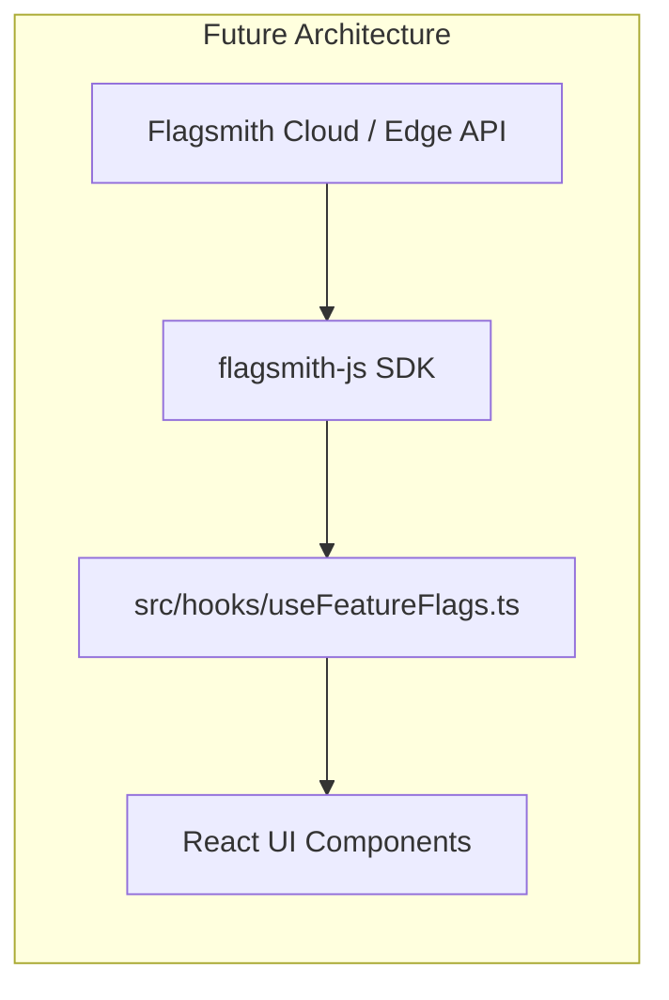

# Feature Flag Architecture & Flagsmith Integration Specification

---

## 1. Current Integration Status

> **IMPORTANT NOTICE:** In FINAL BOARDING v1.0.0, the feature flag architecture is **prepared and integration-ready**, but the remote Flagsmith SDK is **not yet connected to a live cloud environment**.
> 
> Currently, feature flags are evaluated through a clean client-side abstraction (`src/hooks/useFeatureFlags.ts`) with user overrides persisted locally in `localStorage`. This ensures the application code is decoupled and ready for drop-in Flagsmith SDK connection without refactoring component logic.

---

## 2. Implemented Feature Flag Schema

The following flags are declared in `src/types/index.ts`:

```typescript
export interface FeatureFlags {
  enableAudioChimes: boolean;          // Terminal audio announcements
  enableSplitFlapAnimation: boolean;   // Vintage split-flap board visuals
  enableStrictRecoveryMode: boolean;   // Strict gating on delayed milestones
  enableEmergencyChecklist: boolean;   // Unblocking directive spotlight
}
```

### Active Flag Definitions

| Flag Key | Type | Default | Description |
| :--- | :--- | :--- | :--- |
| `enableAudioChimes` | Boolean | `true` | Enables the Web Audio API synthesizer for departure chimes and flap clicks. |
| `enableSplitFlapAnimation` | Boolean | `true` | Displays segmented characters with horizontal split seams. |
| `enableStrictRecoveryMode` | Boolean | `true` | Isolates disrupted milestones into the Recovery Radar and requires explicit rebooking. |
| `enableEmergencyChecklist` | Boolean | `true` | Highlights the top critical unblocking task on the radar dashboard. |

---

## 3. Future Flagsmith SDK Integration Architecture

When connecting Flagsmith in future releases, the transition requires updating only `src/hooks/useFeatureFlags.ts`:



### Drop-in Code Blueprint

```typescript
import flagsmith from 'flagsmith';

// Initialize Flagsmith Client in src/main.tsx or Provider
await flagsmith.init({
  environmentID: import.meta.env.VITE_FLAGSMITH_ENV_ID,
  onChange: (oldFlags, params) => {
    // Re-render UI when remote flags change
  }
});

// useFeatureFlags.ts evaluation:
export function useFeatureFlags() {
  const isFeatureEnabled = (key: keyof FeatureFlags): boolean => {
    return flagsmith.hasFeature(key);
  };
  // ...
}
```

---

## 4. Planned Experimentation Matrix

Using Flagsmith remote configuration, the following experiments can be conducted to evaluate behavioral impact:

1. **Audio Urgency Experiment:** Measure milestone completion velocity for users with default audio chimes enabled vs. silent mode.
2. **Strict vs. Soft Recovery Experiment:** Compare task recovery rates when delayed milestones strictly gate project progress versus displaying soft calendar reminders.

