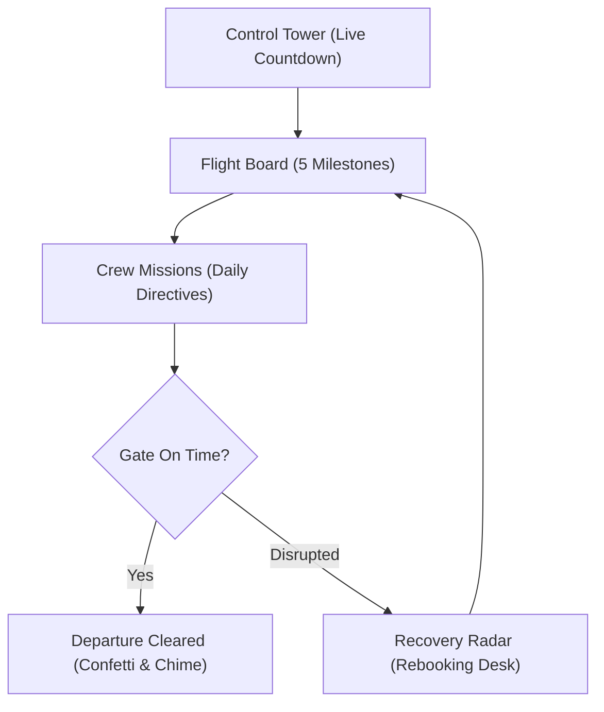

# Project Overview: FINAL BOARDING

> **"Every Deadline Is a Departure Time."**

---

## 1. Executive Summary

**FINAL BOARDING** is an airport-terminal-inspired project execution and deadline-management system built with React, Vite, TypeScript, and Tailwind CSS v4. Traditional project trackers often present deadlines as passive calendar entries, leading to scope drift, Parkinson's Law, and last-minute panic. FINAL BOARDING reframes project delivery through the psychology of an airport departure gate: flight departures are fixed, gates close strictly on schedule, and delays trigger immediate rebooking protocols.

The system is designed to turn hackathon milestones and project deadlines into an urgent, motivating, and visually striking operational control interface.

---

## 2. Core Value Proposition

| Traditional Tracker | FINAL BOARDING Control Interface |
| :--- | :--- |
| Deadlines viewed as flexible calendar targets | Deadlines experienced as scheduled departure times |
| Vague to-do lists without operational urgency | Daily crew mission directives mapped to specific flight gates |
| Overdue tasks quietly sit in backlog | Recovery Radar actively flags disruptions and demands rebooking |
| Bland tabular enterprise dashboard | High-contrast glassmorphism airport aesthetic with amber glow and chime telemetry |

---

## 3. Key Operational Pillars

1. **Control Tower:** Real-time ticking split-flap countdown down to the exact second, accompanied by overall flight completion metrics.
2. **Flight Board:** A 5-stage runway timeline mapping project phases from flight plan to final wheels-up departure.
3. **Crew Missions:** Tactical daily task checklist categorized by avionics, pre-flight, payload, quality, and final runway stages.
4. **Recovery Radar:** Automatic alert triage diagnosing overdue milestones and disrupted tasks, paired with a dedicated flight rebooking desk.
5. **Avionics & Experimentation:** Client-side configuration console with feature flag abstraction prepared for Flagsmith remote experimentation.

---

## 4. Target Use Cases

- **Hackathon Competitors:** Fast-paced time-boxed sprints requiring strict alignment between ideation, MVP release, QA, and final submission.
- **Sprint Engineers & Founders:** High-intensity delivery windows where missing a product launch carries high opportunity costs.
- **Solo Builders:** Solo operators who benefit from persistent daily visual anchors and audible milestone feedback.

