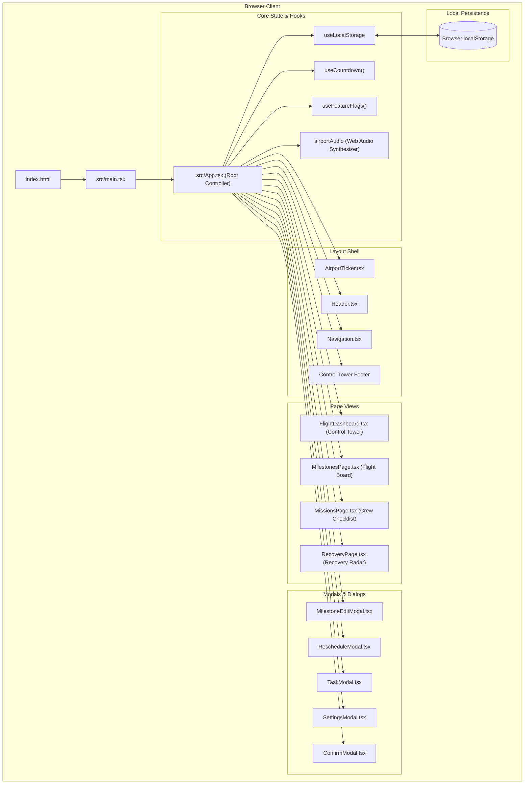
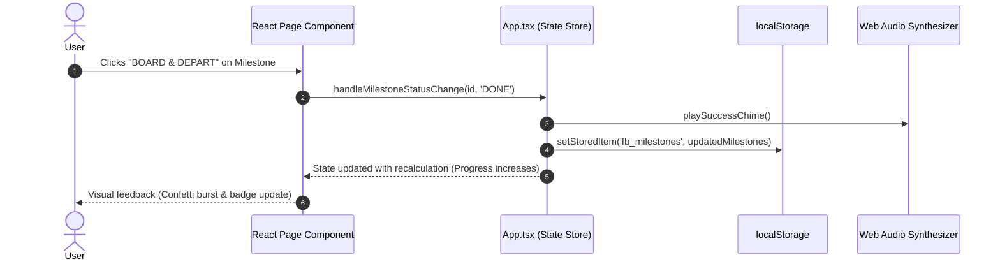
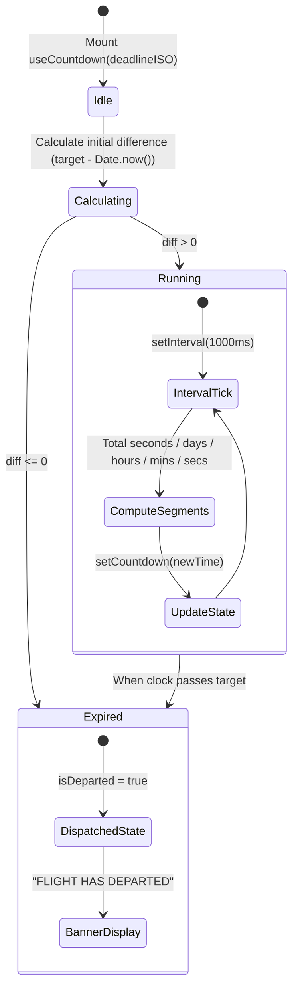

# System Architecture: FINAL BOARDING

---

## 1. High-Level Architectural Diagram

FINAL BOARDING is a modern single-page client architecture built on React 19, TypeScript, and Vite. All computational state, audio synthesis, and persistence operate natively within the browser environment.



---

## 2. Component Hierarchy & Responsibilities

| Component / File | Architectural Layer | Primary Responsibility |
| :--- | :--- | :--- |
| `src/main.tsx` | Entry Point | Bootstraps React DOM root with StrictMode. |
| `src/App.tsx` | Orchestrator | Owns primary application state, modal controls, tab routing, and event delegation. |
| `src/components/layout/Header.tsx` | Layout | Displays brand, callsign, sound toggle button, reset trigger, and avionics config button. |
| `src/components/layout/AirportTicker.tsx` | Layout | Displays live UTC system clock, flight control status, and hackathon banner. |
| `src/components/layout/Navigation.tsx` | Layout | Provides flight control tabs with real-time alert badges. |
| `src/components/dashboard/LiveCountdown.tsx` | Dashboard UI | Renders live countdown with split-flap segments; handles expired flight states. |
| `src/components/dashboard/FlightMetrics.tsx` | Dashboard UI | Calculates overall progress, gate clearance, task ratios, and system status. |
| `src/components/dashboard/NextDepartureCard.tsx` | Dashboard UI | Highlights immediate upcoming gate with target dates and required deliverable. |
| `src/components/milestones/MilestoneTimeline.tsx` | Milestone UI | Visual runway timeline connecting all 5 milestone nodes. |
| `src/components/milestones/MilestoneCard.tsx` | Milestone UI | Renders individual milestone status, gate metadata, deliverable, and actions. |
| `src/components/milestones/MilestoneEditModal.tsx` | Dialog | Form to update milestone details, dates, gates, and statuses. |
| `src/components/milestones/RescheduleModal.tsx` | Dialog | Dedicated rebooking desk to revise delayed flight departure dates with rationale. |
| `src/components/missions/DailyMissionBoard.tsx` | Mission UI | Crew task board with progress bar, filter pills, and empty states. |
| `src/components/missions/TaskItem.tsx` | Mission UI | Interactive checklist item with category badges, priority tiers, and sound triggers. |
| `src/components/recovery/RecoveryRadar.tsx` | Recovery UI | Diagnostic engine identifying overdue gates and tasks; recommends next unblocking directive. |
| `src/components/settings/SettingsModal.tsx` | Settings UI | Form to edit project metadata, deadline, feature flags, and factory reset. |
| `src/components/ui/GlassCard.tsx` | Design System | Translucent frosted glass panel with border and amber glow options. |
| `src/components/ui/SplitFlapDisplay.tsx` | Design System | Mechanical split-flap character segment display. |
| `src/components/ui/StatusBadge.tsx` | Design System | Airport gate status badge with pulsing LED indicators. |

---

## 3. Data Flow Architecture



---

## 4. Countdown Lifecycle Flow



---

## 5. Web Audio Synthesis Architecture

Rather than relying on external MP3 audio files that introduce latency, network dependencies, or playback failures, FINAL BOARDING implements a custom Web Audio API synthesizer (`src/utils/sound.ts`):

- **Two-Tone Announcement Chime (Ding-Dong):**
  - Sine oscillator note 1: F5 (698.46 Hz) with linear attack and exponential decay.
  - Sine oscillator note 2: C6 (1046.5 Hz) triggered at +350ms offset.
- **Split-Flap Mechanical Click:**
  - Triangle oscillator dropping from 180 Hz to 40 Hz over 40ms to simulate mechanical flap flipping.
- **Milestone Celebration Chime:**
  - 4-note ascending major arpeggio (C5, E5, G5, C6) with smooth release.
- **Recovery Warning Tone:**
  - Dual-pitch sawtooth alert tone (320 Hz / 260 Hz).

---

## 6. Feature Flag Architecture (Flagsmith Preparation)

The application includes an experiment-ready feature flag architecture located at `src/hooks/useFeatureFlags.ts`.

```typescript
// Flagsmith Drop-In Abstraction Schema
export interface FeatureFlags {
  enableAudioChimes: boolean;
  enableSplitFlapAnimation: boolean;
  enableStrictRecoveryMode: boolean;
  enableEmergencyChecklist: boolean;
}
```

The hook exposes `isFeatureEnabled(key)` and currently evaluates against locally persisted overrides in `localStorage`. When the official Flagsmith SDK is connected, this hook acts as a zero-refactor adapter delegating directly to `flagsmith.hasFeature(key)`.
